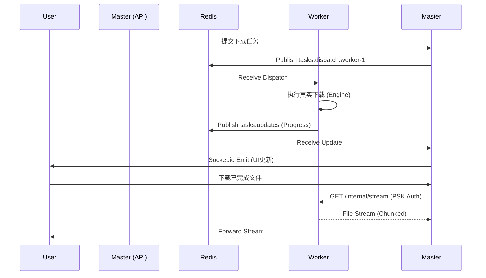

# 分布式下载引擎与文件网关设计 (Scheme C - 强化版)

**状态**：Accepted (2026-10-14)
**关联方案**：Scheme C (分布式架构)
**核心改进**：引擎解耦、文件网关代理、指令闭环

---

## 1. 背景与目标
在完成分布式骨架（心跳、任务分发）后，系统需要解决真实的下载执行、跨节点指令控制以及独立磁盘环境下的文件访问问题。本设计旨在实现 Master 节点作为统一入口，透明地代理分布在不同 Worker 节点上的文件流。

## 2. 详细设计

### 2.1 引擎解耦 (Engine Decoupling)
将 `apps/api` 中的 `HttpEngine` 和 `TorrentEngine` 提取并重构为纯执行逻辑。

- **位置**：`packages/shared/src/engines` (或新建 `packages/engine`)。
- **架构**：继承自 `EventEmitter`。
- **事件定义**：
  - `progress`: 包含已下载字节、总字节、瞬时速度。
  - `complete`: 下载完成，返回最终文件路径。
  - `error`: 抛出底层错误（如磁盘满、上游 404）。
- **解耦逻辑**：
  - 移除所有对 `prisma` 的调用。
  - 移除所有对 `socket.io` 的调用。
  - 通过构造函数注入 `downloadRoot` 和 `logger`。

### 2.2 文件代理网关 (Master Gateway)
解决独立磁盘环境下用户无法直接访问 Worker 节点文件的问题。

- **工作流**：
  1. 用户发起请求：`GET /api/files/:id/download`。
  2. Master 节点查询 DB：获取任务所属的 `workerId` 及内网 `workerUrl`。
  3. Master 发起内部请求：使用预共享密钥（PSK）调用 Worker 的流式接口 `GET /internal/stream/:filename`。
  4. 管道转发：Master 使用 `response.body.pipe(res)` 将数据流实时转发给用户。
- **安全性**：
  - Worker 节点仅监听内网 IP。
  - 所有内部接口必须携带 `X-Internal-Secret` 校验。

### 2.3 指令闭环 (Control Plane)
实现对远程任务的精确控制。

- **Redis 频道**：`tasks:control:${workerId}`。
- **指令集**：
  - `PAUSE`: 中断当前引擎的 AbortController，保留 `.part`。
  - `RESUME`: 重新触发引擎 `start()`。
  - `CANCEL`: 中断并物理删除临时文件。
- **反馈机制**：Worker 执行完控制指令后，通过 `TASKS_UPDATES` 频道立即上报最新的 `status`（如 `paused`）。

### 2.4 Worker 节点内部服务
`apps/worker` 将新增一个轻量级的 HTTP 服务（基于原生 `http` 或 `express`）：
- **端口**：默认 `5002`（内网）。
- **端点**：
  - `GET /internal/stream/*`: 供 Master 拉取文件流。
  - `GET /internal/health`: 供负载均衡探测。
  - `POST /internal/plugin-hook`: 触发本地插件执行（如生成缩略图）。

## 3. 数据流图 (Sequence)

## 4. 实施阶段 (Implementation Plan)

### 阶段 1：引擎层提取 (Core)
- [ ] 创建 `packages/shared/src/engines`。
- [ ] 迁移 HTTP 引擎并实现事件抛出。
- [ ] 迁移 WebTorrent 引擎。

### 阶段 2：Worker 增强 (Executor)
- [ ] 在 `apps/worker` 中集成真实引擎。
- [ ] 实现 `TaskService` 对 `tasks:control` 频道的监听。
- [ ] 搭建内网流式 HTTP 服务器。

### 阶段 3：Master 闭环 (Controller)
- [ ] 重构 `DownloadManager` 补全远程指令发送逻辑。
- [ ] 实现 `/api/files/:id/download` 的代理逻辑。
- [ ] 增加内部通信的 PSK 鉴权配置。

## 5. 风险评估
- **带宽瓶颈**：Master 节点在代理下载时会承受两倍流量。*对策：未来可引入 Scheme C 选项 B (直连模式) 作为补充。*
- **连接超时**：大文件代理时连接稳定性。*对策：在 Master 转发时设置合理的超时时间，并支持断点续传代理。*
